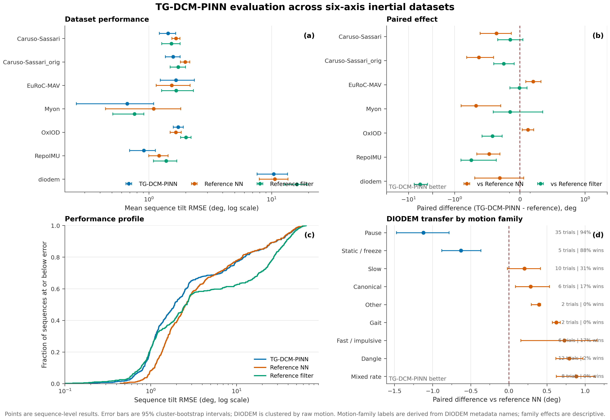

<h1 align="center">TG-DCM-PINN</h1>

<p align="center">
  Target-Gated Direction-Cosine Physics for Six-Axis Inertial Attitude Estimation
</p>

<p align="center">
  <a href="https://github.com/GinkgoQ/TG-DCM-PINN/actions/workflows/ci.yml"></a>
  <a href="LICENSE"></a>
  
  
</p>

TG-DCM-PINN is a recurrent estimator for tilt from accelerometer and gyroscope
measurements. Its training objective treats inertial physics as conditional
evidence: gyroscope consistency is applied only to target transitions supported
by the measured angular increment, while gravity alignment is weighted by an
IMU-derived confidence function.

The released model retains a compact deployment interface. Physics gates,
targets, and direction-cosine losses are used during training; inference requires
only acceleration, angular rate, timestep, and recurrent state.

## Release contents

| Item            | Released artifact                                       |
| --------------- | ------------------------------------------------------- |
| Input           | `[acc_x, acc_y, acc_z, gyr_x, gyr_y, gyr_z, dt]`        |
| Output          | scalar-first Hamilton quaternion, `wxyz`, body to world |
| Estimator       | 2-layer GRU, hidden size 200                            |
| Checkpoint      | [`checkpoints/tg_dcm.pt`](checkpoints/tg_dcm.pt)        |
| Default weights | exponential moving average                              |
| Primary metric  | yaw-invariant tilt RMSE                                 |
| Evaluation      | 559 sequences: 137 standard + 422 DIODEM segments       |
| Poster          | [`docs/assets/poster/`](docs/assets/poster/)            |

The checkpoint contains tensors and primitive metadata only. It is loaded with
PyTorch's `weights_only=True` mode. Its SHA-256 digest is recorded in
[`checkpoints/SHA256SUMS`](checkpoints/SHA256SUMS).

## Method

For a normalized quaternion `q = [w, x, y, z]`, the body-frame world-vertical
direction is evaluated directly from the direction-cosine matrix:

```text
h(q) = [2(xz - wy), 2(yz + wx), 1 - 2(x² + y²)].
```

Both physics terms operate on this observable direction rather than on raw
quaternion components.

```mermaid
flowchart LR
    X[IMU sequence] --> N[2-layer GRU]
    N --> Q[Quaternion predictions]
    Q --> H[Vertical direction h(q)]
    Y[Target sequence] --> T{Target propagation error <= 2 deg?}
    X --> T
    T -->|yes| D[Gyroscope dynamics loss]
    T -->|no| Z1[Zero dynamics contribution]
    X --> G{Gravity confidence > 1e-4?}
    G -->|yes| A[Weighted gravity loss]
    G -->|no| Z2[Zero gravity contribution]
    H --> D
    H --> A
```

### Supervised tilt

For quaternion error `q_e = q_pred * conj(q_target)`, the tilt error is

```text
tilt(q_e) = 2 atan2(sqrt(x_e² + y_e²), sqrt(w_e² + z_e²)).
```

The supervised term applies a Charbonnier penalty to valid target frames and a
`0.01` unit-quaternion norm regularizer to every prediction.

### Target-gated dynamics

The target at time `t` is propagated with `gyr_t * dt_t`. A pair contributes only
when both targets and the inertial increment are finite and the propagated target
agrees with the next target within `2°`. Accepted pairs propagate the prediction
with the same increment, remove a `0.15°` dead zone, and apply a Charbonnier
penalty with `0.50°` scale. The branch weight is `0.10`.

### Confidence-gated gravity

Gravity confidence is the product of three Gaussian factors:

```text
acceleration magnitude: sigma = 0.25 m/s²
jerk:                  sigma = 45.0 m/s³
angular rate:          sigma = 1.4 rad/s
```

Non-finite frames and combined confidence values at or below `1e-4` contribute
zero. Accepted frames align `h(q)` with normalized acceleration, remove a `0.20°`
dead zone, apply the `0.50°` Charbonnier penalty, retain continuous confidence
weighting, and use branch weight `0.05`.

The complete implementation is in
[`src/tg_dcm/losses.py`](src/tg_dcm/losses.py). The full derivation is in
[`docs/reference/mathematics.md`](docs/reference/mathematics.md).

## Results

Sequence-level tilt RMSE in degrees:

| Dataset                 |   N | TG-DCM-PINN | RIANN |   VQF |
| ----------------------- | --: | ----------: | ----: | ----: |
| Caruso-Sassari          |  18 |        1.43 |  1.66 |  1.53 |
| Caruso-Sassari original |  18 |        1.58 |  1.98 |  1.73 |
| EuRoC-MAV               |   6 |        1.66 |  1.53 |  1.67 |
| Myon                    |   3 |        0.67 |  1.09 |  0.76 |
| OxIOD                   |  71 |        1.74 |  1.66 |  2.00 |
| RepoIMU                 |  21 |        0.91 |  1.21 |  1.38 |
| DIODEM                  | 422 |       10.41 | 10.61 | 16.03 |

On the 137-sequence standard split, mean tilt RMSE is `1.521°`. The paired
difference against the neural reference is `-0.091°`, with a sequence-bootstrap
95% interval of `[-0.147°, -0.036°]`.

DIODEM contains 422 segments from 86 raw motions. Its error distribution remains
heavy-tailed: median `2.70°`, p95 `44.20°`, and maximum `62.38°`. The clustered
paired interval against the neural reference crosses zero. The released evidence
therefore supports a standard-domain mean improvement, not uniform improvement
across datasets or motion regimes.



Machine-readable sequence metrics, reliability statistics, paired effects, and
vector figures are under [`results/full_evaluation/`](results/full_evaluation/).
The protocol and claims boundary are documented in
[`docs/evaluation.md`](docs/evaluation.md).

## Installation

Clone the repository and create an isolated environment:

```bash
git clone https://github.com/GinkgoQ/TG-DCM-PINN.git
cd TG-DCM-PINN
python -m venv .venv
source .venv/bin/activate
python -m pip install --upgrade pip
python -m pip install -e ".[all]"
```

Install only the required surface when appropriate:

```bash
python -m pip install -e ".[evaluation]"  # released checkpoint evaluation
python -m pip install -e ".[train]"       # training
python -m pip install -e ".[data]"        # dataset preparation
```

## Data

Datasets are not redistributed. Prepare the standard datasets with

```bash
python scripts/prepare_data.py --list
python scripts/prepare_data.py --data-dir data
```

DIODEM uses prepared HDF5 segments with `acc`, `gyr`, `quat`, and `timestamps`
datasets. Exact schemas, units, frame conventions, and directory layout are in
[`docs/data.md`](docs/data.md).

## Evaluation

```bash
python scripts/evaluate.py \
  --split test \
  --datasets OxIOD EuRoC-MAV Caruso-Sassari Caruso-Sassari_orig RepoIMU Myon diodem \
  --data-dir data \
  --diodem-root diodem \
  --sequence-workers 8 \
  --out-dir results/full_evaluation
```

Single-sequence smoke evaluation:

```bash
python scripts/evaluate.py \
  --datasets diodem \
  --diodem-root diodem \
  --max-seqs 1 \
  --no-plot
```

Regenerate figures from the released per-sequence table without rerunning model
inference:

```bash
python scripts/plot_results.py results/full_evaluation/tables/per_sequence.csv
```

## Training

```bash
python scripts/train.py \
  --data-dir data \
  --out-dir runs \
  --run-name tg_dcm
```

The selected configuration is fixed in [`configs/model.yaml`](configs/model.yaml)
and described in [`docs/reference/configuration.md`](docs/reference/configuration.md).
Training metadata for the released checkpoint is under [`training/`](training/).
The release does not claim component-level attribution because controlled
multi-seed ablations are not included.

## Repository structure

```text
checkpoints/                 weights-only released checkpoint and checksum
configs/                     selected model and loss configuration
docs/                        method, data, evaluation, derivation, poster
results/                     released tables and figures
scripts/                     preparation, training, evaluation, plotting
src/tg_dcm/                  importable implementation
tests/                       geometry, gates, archive safety, evaluation
training/                    selected-run configuration and metrics
```

## Development

```bash
python -m pip install -e ".[all,dev]"
ruff check .
ruff format --check .
pytest -q
python -m build
twine check dist/*
```

Contribution and reporting policies are defined in
[`CONTRIBUTING.md`](CONTRIBUTING.md) and [`SECURITY.md`](SECURITY.md).

## Citation

Repository metadata are provided in [`CITATION.cff`](CITATION.cff). Until a
paper DOI is assigned, cite the software release:

```bibtex
@software{asgharpoor_golroudbari_2026_tg_dcm_pinn,
  author  = {Arman Asgharpoor Golroudbari},
  title   = {TG-DCM-PINN: Target-Gated Direction-Cosine Physics for Six-Axis Inertial Attitude Estimation},
  year    = {2026},
  version = {0.1.0},
  url     = {https://github.com/GinkgoQ/TG-DCM-PINN}
}
```

## License and attribution

Apache-2.0. See [`LICENSE`](LICENSE). The estimator and
data-pipeline lineage includes the Apache-2.0.
