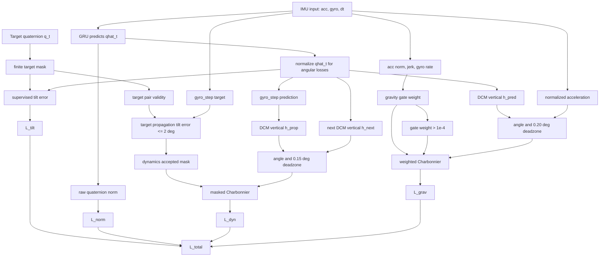

# TG-DCM Mathematics

This file derives the equations implemented in `src/tg_dcm/losses.py`.

The model receives IMU samples:

```text
x_t = [a_t, omega_t, dt_t]
a_t in R^3
omega_t in R^3
dt_t in R
```

The network predicts one quaternion per timestep:

```text
qhat_t = [w, x, y, z]
```

All quaternions use scalar-first Hamilton order:

```text
q = [w, x, y, z]
```

The target quaternion is:

```text
q_target,t = [w_target,t, x_target,t, y_target,t, z_target,t]
```

Only finite target quaternions are used in supervised and target-gated terms.

## 0. Degree-to-Radian Constants

The code stores angular thresholds in radians:

```text
rad = deg * pi / 180
```

Implemented values:

```text
2.0 deg  = pi / 90   rad = 0.034906585
0.15 deg = pi / 1200 rad = 0.002617994
0.20 deg = pi / 900  rad = 0.003490659
0.5 deg  = pi / 360  rad = 0.008726646
```

Purpose: keep human-readable configuration in degrees and compute losses in radians.

## 1. Quaternion Normalization

The raw model output is not guaranteed to be a unit quaternion. The code normalizes it before angular calculations:

```text
q_bar = q / max(||q||, eps)
```

where:

```text
||q|| = sqrt(w^2 + x^2 + y^2 + z^2)
eps = 1e-7
```

Implemented as:

```python
qnorm(q) = F.normalize(q, dim=-1, eps=EPS)
```

Purpose: angular formulas assume unit quaternions.

## 2. Quaternion Conjugate

For a unit quaternion:

```text
q = [w, x, y, z]
```

the inverse rotation is the conjugate:

```text
q* = [w, -x, -y, -z]
```

Implemented as:

```python
qconj(q) = [q_w, -q_x, -q_y, -q_z]
```

Purpose: compare two orientations through a relative quaternion.

## 3. Quaternion Multiplication

For:

```text
a = [aw, ax, ay, az]
b = [bw, bx, by, bz]
```

Hamilton multiplication is:

```text
a otimes b =
[
  aw bw - ax bx - ay by - az bz,
  aw bx + ax bw + ay bz - az by,
  aw by - ax bz + ay bw + az bx,
  aw bz + ax by - ay bx + az bw
]
```

Implemented in `qmul`.

Purpose: compose rotations and build relative orientation errors.

## 4. Relative Quaternion Error

To compare prediction and target, the code computes:

```text
q_err = normalize(qhat otimes q_target*)
```

where:

```text
q_target* = conjugate(q_target)
```

If prediction and target match, then:

```text
q_err = [1, 0, 0, 0]
```

Any nonzero vector part represents angular disagreement.

## 5. Tilt Error From the Relative Quaternion

Let:

```text
q_err = [w, x, y, z]
```

The implemented tilt error is:

```text
e_tilt = 2 atan2(
  sqrt(x^2 + y^2),
  sqrt(w^2 + z^2)
)
```

Code:

```python
sin_half_tilt = sqrt(x^2 + y^2)
cos_half_tilt = sqrt(w^2 + z^2)
e_tilt = 2 * atan2(sin_half_tilt, cos_half_tilt)
```

Derivation:

A unit quaternion can be separated into two parts:

```text
[w, x, y, z]
```

The `x` and `y` components change the vertical direction. The `w` and `z` components preserve rotation around that vertical direction. Therefore:

```text
sin(e_tilt / 2) = sqrt(x^2 + y^2)
cos(e_tilt / 2) = sqrt(w^2 + z^2)
```

Then:

```text
e_tilt / 2 = atan2(sin(e_tilt / 2), cos(e_tilt / 2))
```

so:

```text
e_tilt = 2 atan2(sqrt(x^2 + y^2), sqrt(w^2 + z^2))
```

Purpose: measure roll-pitch disagreement while ignoring rotation around the vertical direction.

## 6. Charbonnier Penalty

The code uses:

```text
rho(r; eps) = sqrt(r^2 + eps^2) - eps
```

Implemented as:

```python
robust_charbonnier(x, eps) = sqrt(x^2 + eps^2) - eps
```

Behavior:

For small residuals:

```text
sqrt(r^2 + eps^2) = eps sqrt(1 + r^2 / eps^2)
```

Using:

```text
sqrt(1 + u) approximately 1 + u/2
```

gives:

```text
rho(r; eps) approximately eps(1 + r^2/(2 eps^2)) - eps
rho(r; eps) approximately r^2 / (2 eps)
```

So near zero it behaves like a smooth quadratic.

For large residuals:

```text
sqrt(r^2 + eps^2) approximately |r|
```

so:

```text
rho(r; eps) approximately |r| - eps
```

So for large errors it behaves like an absolute-value penalty.

Purpose: keep gradients smooth near zero and reduce the effect of large outliers.

## 7. Supervised Tilt Loss

The supervised loss uses target quaternions only where all target components are finite.

For each valid timestep:

```text
qhat_t_bar = normalize(qhat_t)
q_t_bar = normalize(q_t)
q_err,t = normalize(qhat_t_bar otimes q_t_bar*)
e_sup,t = e_tilt(q_err,t)
```

The supervised tilt penalty is:

```text
L_tilt = mean_valid rho(e_sup,t; 1e-3)
```

The raw quaternion norm penalty is:

```text
L_norm = mean_t (||qhat_t|| - 1)^2
```

The implemented supervised loss is:

```text
L_sup = 1.0 * L_tilt + 0.01 * L_norm
```

Purpose: train tilt accuracy and keep the raw output close to a valid unit quaternion.

## 8. Gyroscope Increment as a Rotation Vector

The gyroscope measures angular rate:

```text
omega_t = [omega_x, omega_y, omega_z] rad/s
```

Over one timestep:

```text
r_t = omega_t dt_t
```

where:

```text
r_t in R^3
```

This is an axis-angle rotation vector. Its magnitude is the rotation angle:

```text
theta_t = ||r_t||
```

and its axis is:

```text
u_t = r_t / theta_t
```

when `theta_t > 0`.

## 9. Exponential Map From Rotation Vector to Quaternion

A rotation of angle `theta` around unit axis `u` is represented by:

```text
Exp(r) = [cos(theta/2), u sin(theta/2)]
```

Since:

```text
u = r / theta
```

then:

```text
Exp(r) = [cos(theta/2), r * sin(theta/2) / theta]
```

The code uses:

```text
theta = ||r||
half = theta / 2
scale = sin(half) / theta
q_delta = [cos(half), r * scale]
```

For very small `theta`, direct division by `theta` is unstable. The code uses the Taylor expansion:

```text
sin(theta/2) / theta = 1/2 - theta^2 / 48 + O(theta^4)
```

So:

```text
scale = 0.5 - theta^2 / 48
```

when:

```text
theta < eps
```

Purpose: convert measured angular increment into a quaternion increment.

## 10. One-Step Gyro Propagation

Given current quaternion `q_t`, gyroscope `omega_t`, and timestep `dt_t`:

```text
r_t = omega_t dt_t
q_delta,t = Exp(r_t)
q_prop,t+1 = normalize(q_t otimes q_delta,t)
```

Implemented as:

```python
gyro_step(q, gyr, dt) = qnorm(qmul(q, qexp(gyr * dt)))
```

Purpose: predict the next orientation implied by the measured angular increment.

## 11. DCM Vertical Direction From a Quaternion

The method needs only tilt, so the code extracts the body-frame world-vertical direction.

Let:

```text
q = [w, x, y, z]
```

The world vertical vector is:

```text
e3 = [0, 0, 1]
```

The body-frame vertical direction is equivalent to rotating `e3` by `q*`:

```text
h(q) = q* otimes [0, e3] otimes q
```

The vector part of this product is:

```text
h(q) = [
  2(xz - wy),
  2(yz + wx),
  1 - 2(x^2 + y^2)
]
```

This is the implemented closed-form DCM expression:

```python
h = gravity_dir_body(q)
```

Direct multiplication derivation:

First form the pure-vector quaternion:

```text
p = [0, 0, 0, 1]
q* = [w, -x, -y, -z]
```

Compute:

```text
q* otimes p =
[
  z,
  -y,
  x,
  w
]
```

Then multiply by `q`:

```text
(q* otimes p) otimes q =
[
  0,
  2xz - 2wy,
  2yz + 2wx,
  w^2 - x^2 - y^2 + z^2
]
```

For a unit quaternion:

```text
w^2 + x^2 + y^2 + z^2 = 1
```

so:

```text
w^2 - x^2 - y^2 + z^2
= (w^2 + z^2) - (x^2 + y^2)
= 1 - 2(x^2 + y^2)
```

Therefore:

```text
h(q) = [
  2(xz - wy),
  2(yz + wx),
  1 - 2(x^2 + y^2)
]
```

Derivation from the rotation matrix:

For scalar-first Hamilton quaternion, the rotation matrix contains:

```text
R(q) =
[
  [1 - 2(y^2 + z^2), 2(xy - wz),     2(xz + wy)],
  [2(xy + wz),       1 - 2(x^2+z^2), 2(yz - wx)],
  [2(xz - wy),       2(yz + wx),     1 - 2(x^2+y^2)]
]
```

The implemented vector is the DCM vertical direction consistent with `qrot(qconj(q), [0,0,1])`:

```text
h(q) = [
  R_31,
  R_32,
  R_33
]
```

so:

```text
h(q) = [
  2(xz - wy),
  2(yz + wx),
  1 - 2(x^2 + y^2)
]
```

Purpose: compare vertical directions instead of full quaternion components.

## 12. Angle Between Two Unit Direction Vectors

For two unit vectors:

```text
a, b in R^3
```

the angle is:

```text
theta = atan2(||a x b||, a dot b)
```

For unit vectors:

```text
||a x b||^2 = ||a||^2 ||b||^2 - (a dot b)^2
```

Since:

```text
||a|| = ||b|| = 1
```

then:

```text
||a x b|| = sqrt(1 - (a dot b)^2)
```

The implemented angle is:

```text
theta = atan2(sqrt(1 - dot^2), dot)
```

with:

```text
dot = clamp(a dot b, -1 + eps, 1 - eps)
```

Purpose: compute stable angular disagreement without explicitly computing the cross product.

## 12.1. Masked Mean

Several loss terms are averaged only over valid samples.

For values:

```text
p_t
```

and binary mask:

```text
m_t in {0, 1}
```

the implemented masked mean is:

```text
masked_mean(p, m) = sum_t m_t p_t / max(sum_t m_t, 1)
```

Purpose: use valid samples only and avoid division by zero when all samples are invalid.

## 13. Target-Gated Dynamics: Target Propagation Test

For a consecutive target pair:

```text
q_t
q_t+1
```

and measured gyro step:

```text
omega_t, dt_t
```

first propagate the target:

```text
q_t^g = gyro_step(q_t, omega_t, dt_t)
```

Then compute the target propagation tilt error:

```text
e_target,t = e_tilt(q_t^g, q_t+1)
```

The pair is accepted only if:

```text
e_target,t <= 2 deg
```

Also required:

```text
q_t finite
q_t+1 finite
omega_t finite
dt_t finite
```

The target gate is:

```text
m_dyn,t =
1, if all validity checks pass and e_target,t <= 2 deg
0, otherwise
```

Purpose: apply gyro-dynamics supervision only where the labelled transition agrees with the measured gyro.

## 14. Target-Gated Dynamics: Prediction Consistency

For accepted pairs, propagate the prediction:

```text
qhat_t^g = gyro_step(qhat_t, omega_t, dt_t)
```

Convert both quaternions into vertical directions:

```text
h_prop,t = h(qhat_t^g)
h_next,t = h(qhat_t+1)
```

Compute their angular disagreement:

```text
e_dyn,t = angle(h_prop,t, h_next,t)
```

Apply the dynamics deadzone:

```text
r_dyn,t = max(e_dyn,t - 0.15 deg, 0)
```

Apply Charbonnier:

```text
p_dyn,t = rho(r_dyn,t; 0.5 deg)
```

Average only over accepted pairs:

```text
L_dyn = sum_t m_dyn,t p_dyn,t / max(sum_t m_dyn,t, 1)
```

Purpose: enforce measured rotational evolution on predicted tilt, but only on trusted transitions.

## 15. Acceleration Magnitude Gate

An accelerometer measures:

```text
a_t = gravity + linear_acceleration
```

Gravity-only magnitude should be close to:

```text
G = 9.81 m/s^2
```

The code computes:

```text
||a_t|| = sqrt(a_x^2 + a_y^2 + a_z^2)
```

and assigns:

```text
m_acc,t = exp(-(||a_t|| - G)^2 / (2 sigma_g^2))
```

where the released configuration uses:

```text
sigma_g = 0.25
```

Purpose: reduce gravity correction when acceleration magnitude is not close to gravity.

## 16. Jerk Gate

The code estimates local acceleration change:

```text
j_t = ||a_t - a_t-1|| / dt_t-1
```

For each adjacent pair, the jerk score is assigned to both neighboring samples using a maximum:

```text
jerk_score_t = max(jerk_score_t, j_t)
jerk_score_t-1 = max(jerk_score_t-1, j_t)
```

Then:

```text
m_jerk,t = exp(-jerk_score_t^2 / (2 sigma_j^2))
```

with:

```text
sigma_j = 45.0
```

Purpose: reduce gravity correction when acceleration is changing quickly.

## 17. Angular-Rate Gate

The code computes gyroscope magnitude:

```text
||omega_t|| = sqrt(omega_x^2 + omega_y^2 + omega_z^2)
```

Then:

```text
m_rate,t = exp(-||omega_t||^2 / (2 sigma_omega^2))
```

with:

```text
sigma_omega = 1.4
```

Purpose: reduce gravity correction during fast rotation.

## 18. Combined Gravity Gate

A sample is valid only if:

```text
a_t finite
omega_t finite
||a_t|| finite
||omega_t|| finite
dt_t finite
```

The continuous gravity confidence is:

```text
m_grav,t = m_acc,t m_jerk,t m_rate,t
```

or explicitly:

```text
m_grav,t =
exp(-(||a_t|| - 9.81)^2 / (2 * 0.25^2))
* exp(-jerk_score_t^2 / (2 * 45.0^2))
* exp(-||omega_t||^2 / (2 * 1.4^2))
```

If the sample is invalid:

```text
m_grav,t = 0
```

The binary mask is:

```text
g_t = 1, if m_grav,t > 1e-4
g_t = 0, otherwise
```

Purpose: keep a differentiable confidence weight while dropping near-zero samples from the denominator.

## 19. Gravity Direction From Acceleration

For accepted gravity samples, acceleration is normalized:

```text
a_unit,t = a_t / max(||a_t||, eps)
```

This treats acceleration direction as a gravity observation only when the gate says it is reliable.

The predicted vertical direction is:

```text
h_pred,t = h(qhat_t)
```

The angular disagreement is:

```text
e_grav,t = angle(h_pred,t, a_unit,t)
```

Apply the gravity deadzone:

```text
r_grav,t = max(e_grav,t - 0.20 deg, 0)
```

Apply Charbonnier:

```text
p_grav,t = rho(r_grav,t; 0.5 deg)
```

Weighted masked mean:

```text
L_grav = sum_t g_t m_grav,t p_grav,t / max(sum_t g_t, 1)
```

Purpose: align predicted vertical direction with measured gravity only when the IMU signal is credible.

## 20. Full Auxiliary Loss

The auxiliary loss combines target-gated dynamics and gravity-gated alignment:

```text
L_aux = 0.10 L_dyn + 0.05 L_grav
```

where:

```text
0.10 = dynamics loss weight
0.05 = gravity loss weight
```

## 21. Full Training Loss

The final implemented training objective is:

```text
L_total = L_sup + L_aux
```

Substitute the components:

```text
L_total =
1.0 L_tilt
+ 0.01 L_norm
+ 0.10 L_dyn
+ 0.05 L_grav
```

Expanded:

```text
L_total =
1.0 mean_valid rho(e_tilt(qhat_t, q_t); 1e-3)
+ 0.01 mean_t (||qhat_t|| - 1)^2
+ 0.10 mean_accepted rho(max(angle(h(gyro_step(qhat_t)), h(qhat_t+1)) - 0.15 deg, 0); 0.5 deg)
+ 0.05 weighted_mean_gravity rho(max(angle(h(qhat_t), a_t / ||a_t||) - 0.20 deg, 0); 0.5 deg)
```

This is the mathematical form of the implemented code.

## 22. What Is Ignored in Each Scenario

Target-gated dynamics:

```text
ignored if sequence length < 2
ignored if q_t is invalid
ignored if q_t+1 is invalid
ignored if gyro_t is invalid
ignored if dt_t is invalid
ignored if target propagation tilt error > 2 deg
ignored inside 0.15 deg prediction-consistency deadzone
```

Gravity-gated anchor:

```text
ignored if acceleration is invalid
ignored if gyro is invalid
ignored if dt is invalid
ignored if m_grav <= 1e-4
downweighted when ||a|| is far from 9.81
downweighted when acceleration changes quickly
downweighted when angular rate is high
ignored inside 0.20 deg gravity-alignment deadzone
```

Supervised tilt:

```text
ignored if the target quaternion is invalid
```

Quaternion norm:

```text
applied to all raw predictions
```

## 23. Implemented Method as a Dataflow


