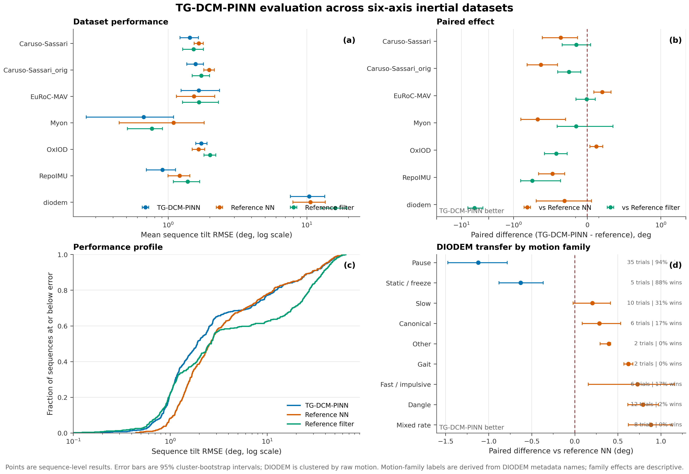
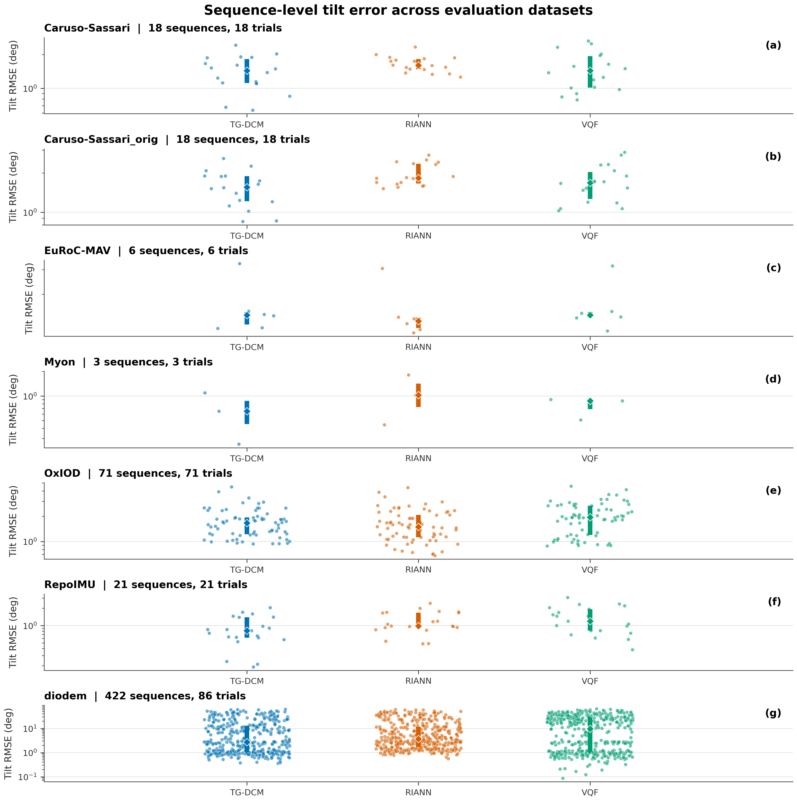

# TG-DCM from First Principles

## A teaching guide to target-gated direction-cosine regularization for six-axis inertial attitude estimation

This report explains TG-DCM for a reader who has not previously worked with
inertial sensors, quaternions, recurrent networks, RIANN, or the evaluation
datasets used in this repository. It starts from the physical measurement
problem, derives the quantities used by the implementation, follows one sample
through training and inference, and then interprets the experimental evidence.

The report is tied to the released implementation and checkpoint. Statements
about the method refer to [the source package](../src/tg_dcm/), the selected model
configuration in [configs/model.yaml](../configs/model.yaml), the training record
in [training/](../training/), and the evaluation tables in
[results/full_evaluation/](../results/full_evaluation/).

---

## 1. What TG-DCM is

TG-DCM is a recurrent orientation estimator trained from accelerometer and
gyroscope measurements. At each sample it receives seven values,

$$
\mathbf{x}_t =
[a_x,a_y,a_z,\omega_x,\omega_y,\omega_z,\Delta t]_t,
$$

and returns a four-component quaternion,

$$
\hat{\mathbf q}_t=[w,x,y,z]_t.
$$

The deployed network is a two-layer gated recurrent unit, or GRU, with 200
hidden units per layer. The architecture and inference interface are the same
as the RIANN model on which this work is based. TG-DCM changes the **training
objective**, not the runtime sensor interface or recurrent architecture.

The central idea is:

> Enforce physical consistency only in observable directions and only when the
> data supporting that constraint are credible.

Two training-only regularizers implement this idea:

1. **Target-gated vertical dynamics.** A transition is used only when the
   measured gyroscope can propagate the current ground-truth orientation close
   to the next ground-truth orientation. The accepted residual then compares
   two *predicted* vertical directions.
2. **Input-gated gravity anchoring.** The predicted vertical direction is
   compared with normalized acceleration, but its weight falls when
   acceleration magnitude, jerk, or angular rate indicates dynamic motion.

Both terms operate on the direction of world vertical expressed in the sensor
frame. A rotation around vertical does not change this direction. The
regularizers therefore constrain roll and pitch without requiring an absolute
yaw reference.

The released checkpoint contains 367,404 learned parameters and stores raw and
exponential-moving-average weights. Evaluation uses the EMA weights by default.

### The result in one paragraph

On the 137-sequence standard test split, mean sequence tilt RMSE is 1.521° for
TG-DCM, 1.612° for RIANN, and 1.768° for VQF. The paired TG-DCM minus RIANN
difference is -0.091° with a 95% interval of [-0.147°, -0.036°]. On 422 DIODEM
segments from 86 retained motions, TG-DCM has a lower mean than RIANN, 10.414°
versus 10.609°, but the clustered difference interval [-0.440°, +0.043°]
includes zero. TG-DCM improves pause and static motions most clearly; sustained
and abrupt motion remains its principal transfer failure. Its DIODEM p95 is
44.20°, slightly worse than RIANN's 43.46°, so the lower mean does not imply
better tail reliability.

---

## 2. The estimation problem

### 2.1 Attitude and orientation

An object's **attitude** is its rotational relationship to a reference frame.
This report uses two frames:

| Symbol | Meaning |
|---|---|
| $\mathcal B$ | Body frame fixed to the IMU sensor |
| $\mathcal W$ | World frame; prepared data use an ENU convention where $+z$ is up |

The quaternion $\mathbf q_{WB}$ maps a body-frame vector to the world frame:

$$
\mathbf v_W = R(\mathbf q_{WB})\mathbf v_B.
$$

The repository abbreviates this convention as `body_to_world`. Quaternions are
stored in scalar-first Hamilton order, `wxyz`.

Roll, pitch, and yaw are a familiar way to describe orientation, but they are
not the representation used internally. Euler angles have convention choices,
wrap discontinuities, and singular configurations. Unit quaternions provide a
continuous four-number representation of three-dimensional rotation, subject
to the constraint $\|\mathbf q\|=1$.

### 2.2 What an IMU measures

A six-axis IMU contains two three-axis sensors.

**Gyroscope.** The gyroscope measures angular velocity in the body frame,
$\boldsymbol\omega_t$ in rad/s. Integrating angular velocity propagates
orientation over short intervals. Bias and noise accumulate under integration,
so gyroscope-only attitude drifts.

**Accelerometer.** The accelerometer measures specific force in m/s². When the
sensor is not undergoing substantial linear acceleration, its normalized output
approximately identifies the world-up direction expressed in the body frame.
This gives an absolute roll-pitch reference. During translation, impact,
vibration, or rapid motion, measured acceleration is not a clean observation of
gravity.

No magnetometer is supplied to TG-DCM. The DIODEM source files contain magnetic
measurements, but the evaluator deliberately uses only accelerometer and
gyroscope channels for all three methods.

### 2.3 What is observable with six axes

Gravity gives a vertical direction. It does not give a direction within the
horizontal plane. Rotating a stationary sensor around world vertical changes
yaw but leaves gravity unchanged. Consequently:

- roll and pitch, jointly called **tilt** or **inclination**, can be corrected
  from accelerometer information when the acceleration is trustworthy;
- absolute yaw cannot be recovered from accelerometer and gyroscope data alone;
- yaw from gyro integration can remain locally smooth, but it has no absolute
  reference and will drift.

This asymmetry determines the entire method. A training objective that treats
absolute yaw as equally observable would ask the network to reproduce a target
that the runtime sensors cannot determine uniquely.

### 2.4 Why the output is still a full quaternion

The model returns a four-component quaternion because downstream systems often
expect a complete rotation and recurrent integration naturally evolves a full
orientation state. The training and primary evaluation metric focus on the
observable tilt component. The estimated yaw should not be interpreted as an
absolute heading unless another sensor supplies heading information.

---

## 3. Quaternion tools used by the method

### 3.1 Unit quaternion

Write a quaternion as a scalar and vector part,

$$
\mathbf q=[w,\mathbf v]=[w,x,y,z], \qquad
w^2+x^2+y^2+z^2=1.
$$

A rotation of angle $\theta$ around a unit axis $\mathbf u$ is

$$
\mathbf q=
\left[\cos\frac{\theta}{2},
      \mathbf u\sin\frac{\theta}{2}\right].
$$

The quaternions $\mathbf q$ and $-\mathbf q$ encode the same physical rotation.
The implementation normalizes quaternions before computing geometric errors,
which removes arbitrary output scale.

### 3.2 Conjugate and inverse

For a unit quaternion,

$$
\mathbf q^{-1}=\mathbf q^*=[w,-x,-y,-z].
$$

The conjugate reverses the represented rotation. It is used to construct the
relative error between a prediction and target.

### 3.3 Hamilton product

For $\mathbf q=[w_q,\mathbf v_q]$ and
$\mathbf p=[w_p,\mathbf v_p]$, the Hamilton product is

$$
\mathbf q\otimes\mathbf p =
\left[
w_qw_p-\mathbf v_q^\top\mathbf v_p,
w_q\mathbf v_p+w_p\mathbf v_q+\mathbf v_q\times\mathbf v_p
\right].
$$

Rotation composition is order-dependent. The code propagates a body-to-world
orientation with a body-frame gyroscope increment as

$$
\mathbf q_{t+1|t}=
\operatorname{normalize}
\left(\mathbf q_t\otimes\operatorname{Exp}(\boldsymbol\omega_t\Delta t_t)\right).
$$

### 3.4 Quaternion exponential for a rotation vector

For rotation vector $\boldsymbol\phi$ with
$\theta=\|\boldsymbol\phi\|$,

$$
\operatorname{Exp}(\boldsymbol\phi)=
\left[
\cos\frac{\theta}{2},
\boldsymbol\phi\frac{\sin(\theta/2)}{\theta}
\right].
$$

The implementation uses a small-angle approximation when $\theta$ is close to
zero. In the dynamics term, $\boldsymbol\phi=\boldsymbol\omega_t\Delta t_t$.

### 3.5 Direction-cosine matrix and vertical direction

A quaternion defines a rotation matrix $R(\mathbf q)$, also called a
direction-cosine matrix. World vertical is

$$
\mathbf e_z=[0,0,1]^\top.
$$

The direction of world vertical expressed in the body frame is

$$
\mathbf h(\mathbf q)=R(\mathbf q)^\top\mathbf e_z.
$$

For the quaternion convention used here, the implementation evaluates this
direction directly as

$$
\mathbf h(\mathbf q)=
\begin{bmatrix}
2(xz-wy)\\
2(yz+wx)\\
1-2(x^2+y^2)
\end{bmatrix}.
$$

This is one row of the direction-cosine matrix in closed form. Computing it
directly is cheaper than constructing a full matrix or rotating a constant
vector through two quaternion multiplications.

Most importantly, $\mathbf h(\mathbf q)$ is unchanged by an additional yaw
rotation around world vertical. It is therefore the representation used by both
TG-DCM auxiliary terms.

---

## 4. The tilt metric

### 4.1 Relative quaternion error

For prediction $\hat{\mathbf q}$ and target $\mathbf q$, define

$$
\mathbf q_e=\hat{\mathbf q}\otimes\mathbf q^*.
$$

After normalization, write $\mathbf q_e=[w_e,x_e,y_e,z_e]$.

### 4.2 Removing yaw

The repository's primary metric is

$$
e_{\text{tilt}}
=2\arccos\left(\sqrt{w_e^2+z_e^2}\right).
$$

The training implementation uses the numerically equivalent form

$$
e_{\text{tilt}}
=2\operatorname{atan2}
\left(
\sqrt{x_e^2+y_e^2},
\sqrt{w_e^2+z_e^2}
\right).
$$

The two forms are equivalent for a normalized quaternion. The `atan2` form is
well behaved near zero during optimization; the evaluation code uses the RIANN
definition with `arccos`.

### 4.3 Worked examples

**Pure yaw error of 30°.** The error quaternion is

$$
\mathbf q_e=[\cos 15^\circ,0,0,\sin15^\circ].
$$

Then $w_e^2+z_e^2=1$, so $e_{\text{tilt}}=0^\circ$. The metric correctly
ignores heading error.

**Pure roll error of 10°.** The error quaternion is

$$
\mathbf q_e=[\cos5^\circ,\sin5^\circ,0,0].
$$

Now $\sqrt{w_e^2+z_e^2}=\cos5^\circ$, so
$e_{\text{tilt}}=10^\circ$.

### 4.4 From frame error to sequence RMSE

For a sequence with valid-frame set $\mathcal V$, the primary reported value is

$$
\operatorname{RMSE}_{\text{tilt}}
=\sqrt{\frac{1}{|\mathcal V|}
\sum_{t\in\mathcal V}e_{\text{tilt},t}^2}.
$$

Each HDF5 sequence produces one RMSE number. Dataset means then average these
sequence RMSE values, so each sequence receives one vote regardless of its
duration.

---

## 5. The starting point: RIANN and VQF

### 5.1 RIANN

RIANN is a recurrent neural orientation estimator proposed by Weber, Gühmann,
and Seel. It was designed to generalize across motion types, sensor hardware,
and sampling rates without dataset-specific filter tuning. The released
TG-DCM model keeps its seven-channel input, two-layer GRU structure, and
four-channel quaternion output. The official RIANN ONNX model is used as a
baseline in this repository.

The relevant distinction is:

| Component | RIANN baseline | TG-DCM |
|---|---|---|
| Input | accelerometer, gyroscope, $\Delta t$ | same |
| Recurrent architecture | 2-layer GRU, hidden size 200 | same |
| Output | quaternion | same |
| Runtime physical gate | none | none |
| Training objective | original supervised formulation | yaw-free supervised tilt plus two gated regularizers |

TG-DCM is therefore an objective-level extension of the RIANN estimator, not a
new observer architecture.

### 5.2 VQF

VQF is a quaternion-based model-driven orientation filter by Laidig and Seel.
The full method supports gyroscope bias estimation and optional magnetometer
processing. This evaluation uses the online **6D** variant: gyroscope and
accelerometer only, with no magnetometer.

VQF is useful as a baseline because it represents a strong engineered filter
rather than a learned recurrent estimator. It also illustrates the central
sensor-fusion problem directly: integrate the gyroscope for short-term motion,
then use suitably filtered acceleration to correct inclination.

---

## 6. The model architecture

### 6.1 Input normalization

Before entering the GRU, each channel is standardized as

$$
\tilde x_i=\frac{x_i-\mu_i}{s_i}.
$$

The checkpoint stores the following constants:

| Channel | Mean $\mu$ | Standard deviation $s$ | Unit before scaling |
|---|---:|---:|---|
| $a_x$ | -0.6845 | 7.1055 | m/s² |
| $a_y$ | -0.4654 | 7.0015 | m/s² |
| $a_z$ | 0.2514 | 7.1748 | m/s² |
| $\omega_x$ | -0.0715 | 2.0147 | rad/s |
| $\omega_y$ | 0.0343 | 1.9856 | rad/s |
| $\omega_z$ | 0.1019 | 2.0225 | rad/s |
| $\Delta t$ | 0.0035 | 0.0018847 | s |

The evaluator supplies raw physical units. The `ScaledModel` wrapper applies
this normalization internally.

### 6.2 What a GRU does

A GRU keeps a hidden state that summarizes previous samples. In a simplified
single-layer form,

$$
\begin{aligned}
\mathbf z_t &= \sigma(W_z\mathbf x_t+U_z\mathbf h_{t-1}+\mathbf b_z),\\
\mathbf r_t &= \sigma(W_r\mathbf x_t+U_r\mathbf h_{t-1}+\mathbf b_r),\\
\tilde{\mathbf h}_t &= \tanh(W_h\mathbf x_t+U_h(\mathbf r_t\odot\mathbf h_{t-1})+\mathbf b_h),\\
\mathbf h_t &= (1-\mathbf z_t)\odot\mathbf h_{t-1}+\mathbf z_t\odot\tilde{\mathbf h}_t.
\end{aligned}
$$

The update and reset gates above are internal neural-network gates. They are
not the target and gravity confidence gates introduced by TG-DCM.

The released model stacks two GRU layers with 200 hidden units each. A linear
projection maps the final recurrent features to four raw quaternion components.
The loss and evaluator normalize those components. A separate norm penalty
encourages the raw output itself to remain near unit length.

### 6.3 Stateful inference

Inference carries the hidden state through the complete sequence. Long
sequences are processed in chunks of at most 50,000 samples to bound GPU memory,
but the final hidden state of one chunk initializes the next. Reinitializing the
state at every chunk would change the estimator and introduce boundary errors.

The runtime computation is conceptually:

```text
hidden = zero
for each time sample:
    x = standardize([acc, gyr, dt])
    raw_q, hidden = GRU(x, hidden)
    q_hat = normalize(raw_q)
```

Neither auxiliary gate is evaluated at runtime.

---

## 7. The complete training objective

The total loss is

$$
\mathcal L
=\mathcal L_{\text{sup}}
+0.10\mathcal L_{\text{dyn}}
+0.05\mathcal L_{\text{grav}}.
$$

All angular calculations are performed in radians inside the loss.

### 7.1 Robust Charbonnier penalty

Each angular residual is passed through

$$
\rho_\epsilon(r)=\sqrt{r^2+\epsilon^2}-\epsilon.
$$

Near zero, this behaves approximately quadratically; for large residuals it
grows approximately linearly. It therefore supplies a smooth gradient without
giving extreme residuals the quadratic leverage they would have under squared
error.

### 7.2 Supervised tilt loss

Let $\mathcal V$ be the set of frames with finite target quaternions. The
supervised term is

$$
\mathcal L_{\text{sup}}
=\frac{1}{|\mathcal V|}\sum_{t\in\mathcal V}
\rho_{10^{-3}}(e_{\text{tilt},t})
+0.01\frac{1}{T}\sum_t
(\|\hat{\mathbf q}^{\text{raw}}_t\|-1)^2.
$$

The first part trains observable inclination. The second prevents the raw
network output from using arbitrary scale even though normalized quaternions
are used for geometric calculations. Frames with missing optical ground truth
are excluded rather than treated as identity orientations.

### 7.3 Target-gated vertical dynamics

This term asks whether consecutive predictions are consistent with the measured
gyroscope.

#### Step 1: determine whether the target transition is credible

Propagate the target at time $t$:

$$
\mathbf q^{gt}_{t+1|t}
=\mathbf q^{gt}_t\otimes
\operatorname{Exp}(\boldsymbol\omega_t\Delta t_t).
$$

Compute the yaw-free difference to the next target. The binary pair mask is

$$
m^{\text{target}}_t=
\mathbb 1\left[
e_{\text{tilt}}(\mathbf q^{gt}_{t+1|t},\mathbf q^{gt}_{t+1})
\le 2^\circ
\right].
$$

Both target frames, the gyroscope, and $\Delta t$ must also be finite. If the
propagated target misses the next target by more than 2°, no dynamics residual
is applied to that transition.

This gate protects the loss from synchronization errors, optical target jumps,
and transitions that are not supported by the measured angular increment.

#### Step 2: compare predictions, not targets

Propagate the prediction using the same gyroscope increment:

$$
\hat{\mathbf q}_{t+1|t}
=\hat{\mathbf q}_t\otimes
\operatorname{Exp}(\boldsymbol\omega_t\Delta t_t).
$$

Convert the propagated and directly predicted orientations to body-frame
vertical directions:

$$
\mathbf h_{t+1|t}=\mathbf h(\hat{\mathbf q}_{t+1|t}),
\qquad
\mathbf h_{t+1}=\mathbf h(\hat{\mathbf q}_{t+1}).
$$

Let $\angle(\mathbf u,\mathbf v)$ denote the angle between unit vectors. The
residual is

$$
r^{\text{dyn}}_t=
\max\left(
\angle(\mathbf h_{t+1|t},\mathbf h_{t+1})-0.15^\circ,
0
\right).
$$

The 0.15° deadzone avoids spending optimization capacity on differences below
the intended precision. The dynamics penalty is

$$
\mathcal L_{\text{dyn}}
=\operatorname{masked\ mean}
\left[
\rho_{0.5^\circ}(r^{\text{dyn}}_t),
m^{\text{target}}_t
\right].
$$

The crucial distinction is that targets choose **where** the term is trusted;
the residual itself links two predictions through sensor dynamics.

### 7.4 Input-gated gravity anchor

This term asks whether acceleration is currently credible as a vertical
reference.

Define acceleration magnitude,

$$
A_t=\|\mathbf a_t\|,
$$

angular rate,

$$
\Omega_t=\|\boldsymbol\omega_t\|,
$$

and finite-difference jerk,

$$
J_t\approx
\frac{\|\mathbf a_t-\mathbf a_{t-1}\|}{\Delta t_{t-1}}.
$$

The implementation assigns each jerk estimate to both neighboring frames using
their maximum. The continuous confidence is the product

$$
g_t =
\exp\left[-\frac{(A_t-9.81)^2}{2(0.25)^2}\right]
\exp\left[-\frac{J_t^2}{2(45)^2}\right]
\exp\left[-\frac{\Omega_t^2}{2(1.4)^2}\right].
$$

The units are inherited from the inputs: m/s² for the acceleration magnitude
scale, m/s³ for the jerk scale, and rad/s for the angular-rate scale. Invalid
measurements receive zero confidence. Values below $10^{-4}$ are omitted from
the masked mean.

Normalize acceleration and compare it with the predicted vertical direction:

$$
\bar{\mathbf a}_t=\frac{\mathbf a_t}{\|\mathbf a_t\|},
\qquad
r^{\text{grav}}_t=
\max\left(
\angle(\mathbf h(\hat{\mathbf q}_t),\bar{\mathbf a}_t)-0.20^\circ,
0
\right).
$$

The gravity loss is

$$
\mathcal L_{\text{grav}}
=\operatorname{masked\ mean}
\left[
g_t\rho_{0.5^\circ}(r^{\text{grav}}_t),
g_t>10^{-4}
\right].
$$

This term does not use the target quaternion. It is a sensor-derived training
constraint whose influence is controlled by the input itself.

### 7.5 Worked confidence examples

If $A_t=9.81$, $J_t=0$, and $\Omega_t=0$, then all three exponentials are one
and $g_t=1$.

If acceleration magnitude differs from gravity by 0.5 m/s², the magnitude term
alone becomes

$$
\exp\left[-\frac{0.5^2}{2(0.25)^2}\right]
=e^{-2}\approx0.135.
$$

If jerk is 45 m/s³, its factor is $e^{-1/2}\approx0.607$. An angular rate of
1.4 rad/s contributes another factor of approximately 0.607. If all three
conditions occur together, the combined confidence is about 0.050. The gravity
residual remains available but contributes little.

If target propagation disagrees with the next target by 3°, the target gate is
zero and the dynamics term is skipped completely. The two gates are therefore
intentionally asymmetric: target consistency is binary, while sensor confidence
is continuous.

### 7.6 Behavior by operating regime

| Regime | Target-gated dynamics | Gravity anchor | Expected model behavior |
|---|---|---|---|
| Stationary or pause | usually available if targets are consistent | strong | vertical correction is emphasized |
| Smooth rotation with normal acceleration magnitude | available | moderate, depending on rate | recurrent prediction and gravity both contribute |
| Translation or impact | target-dependent | weak because magnitude/jerk depart from static conditions | recurrent and gyroscope-supported behavior dominates |
| Target dropout or synchronization fault | disabled | independent of target availability | no unreliable dynamics supervision |
| Fast sustained motion | possibly available | weak because rate and jerk are high | limited direct correction; transfer depends on learned recurrent dynamics |

This table explains the DIODEM pattern observed later: the method helps most in
pause and static conditions, while sustained dynamic regimes remain difficult.
It is a mechanistic interpretation, not an ablation result.

---

## 8. Data and preprocessing

### 8.1 Training, validation, and standard test split

The current data directory resolves to:

| Split | Files | Composition |
|---|---:|---|
| Train | 36 | 33 Myon files and 3 TUM-VI room files |
| Validation | 6 | 3 held-out Myon subjects and 3 held-out TUM-VI room files |
| Standard test | 137 | 3 Myon test subjects plus 134 external sequences |

Myon subject IDs 14, 21, and 39 form validation; IDs 22, 29, and 35 form the
Myon test subset. TUM-VI rooms 1–3 are used for training and the remaining
prepared TUM-VI rooms for validation. External standard datasets are reserved
for testing.

The standard test composition is:

| Dataset | Sequences |
|---|---:|
| Caruso-Sassari | 18 |
| Caruso-Sassari original preparation | 18 |
| EuRoC-MAV | 6 |
| Myon held-out subjects | 3 |
| OxIOD | 71 |
| RepoIMU | 21 |
| **Total** | **137** |

### 8.2 Standard HDF5 schema

| Stored channel | Meaning | Unit | Shape |
|---|---|---|---|
| `acc_x`, `acc_y`, `acc_z` | accelerometer | m/s² | `(T,)` |
| `gyr_x`, `gyr_y`, `gyr_z` | gyroscope | rad/s | `(T,)` |
| `opt_a`, `opt_b`, `opt_c`, `opt_d` | reference quaternion `wxyz` | unitless | `(T,)` |
| `dt` | sample interval | s | `(T,)` |

### 8.3 Sampling-rate augmentation

Training files are resampled on the fly to 427 linearly spaced target rates
between 50 and 500 Hz. This exposes the recurrent estimator to a wide range of
sample intervals. The sample interval is also an explicit input, allowing the
network to condition its temporal update on the actual rate.

Training windows contain 9,000 resampled samples. Their physical duration
therefore ranges from 18 s at 500 Hz to 180 s at 50 Hz. Recurrent optimization
uses subsequences of 1,800 samples while carrying state through the window. The
window start step is 60 samples, producing substantial overlap.

A weighted replacement sampler compensates for different numbers of windows
per file-rate entry. Each epoch contains 300 batches of 64 sampled windows. The
validation loader uses the original prepared sampling rates and sequential
non-overlapping 9,000-sample windows. Test sequences are evaluated in full.

### 8.4 Sensor and orientation augmentation

Training applies three augmentation families:

1. quaternion-consistent coordinate rotation of the IMU and target;
2. gyroscope bias augmentation with configured per-axis scales approximately
   0.0065 rad/s and probability 0.1067;
3. grouped accelerometer and gyroscope noise augmentation with configured scales
   0.6410 m/s² and 0.00712 rad/s and probability 0.6123.

The first preserves the physical relationship between input and target while
preventing the model from associating a specific sensor axis with a fixed world
direction. Bias and noise augmentations expose the network to sensor variation.

### 8.5 DIODEM as external transfer data

DIODEM is a synchronized optical and inertial dataset of five-segment kinematic
chains. The local prepared version uses:

| Property | Value |
|---|---|
| IMU sampling rate | nominal 40 Hz |
| Optical rate for arm experiments | 30 Hz |
| Optical rate for gait experiments | 120 Hz |
| World frame | ENU |
| Quaternion | `wxyz`, body to world |
| IMU variant | rigid mounting |
| Segments per motion | nominally 5 |
| Source motions | 88 |

Reference quaternions are derived from OptiTrack optical motion capture and
interpolated to IMU timestamps in the prepared files. Although magnetic data
exist, they are not supplied to the tested estimators.

The local tree contains 435 prepared HDF5 segment files, including 13 files
under `questionable/`. Default evaluation excludes those 13 and retains 422
segments grouped into 86 raw experiment-motion trials. This grouping matters
for uncertainty estimation because five body segments from one motion share the
same experimental event and cannot be treated as fully independent trials.

DIODEM uses a second HDF5 schema:

| Stored channel | Unit | Shape |
|---|---|---|
| `acc` | m/s² | `(T,3)` |
| `gyr` | rad/s | `(T,3)` |
| `quat` | unit quaternion, `wxyz` | `(T,4)` |
| `timestamps` | s | `(T,)` |

The evaluator derives per-sample $\Delta t$ from timestamps and uses the median
positive interval as a fallback. DIODEM's nominal 40 Hz rate is below the
50–500 Hz range used in training-rate augmentation, making it a genuine
sampling-rate and motion-domain transfer test.

---

## 9. Training procedure

### 9.1 Configuration

| Setting | Released value |
|---|---:|
| Planned epochs | 512 |
| Batch size | 64 |
| Sampled train batches per epoch | 300 |
| Initial learning rate | 0.003 |
| Weight decay | 0.01 |
| Scheduler parameter `pct_start` | 0.15 |
| Window length | 9,000 samples |
| Recurrent subsequence | 1,800 samples |
| Gradient clipping | 1.0 |
| Random seed | 42 |
| EMA maximum decay | 0.9999 |

The optimizer is Ranger with $\beta=(0.95,0.99)$ and $\epsilon=10^{-6}$.
The training code uses a flat/cosine learning-rate schedule, orthogonal
recurrent initialization, non-finite gradient guards, rollback after a
non-finite epoch, and checkpointing every epoch.

On CUDA, the implementation enables BF16 computation, CUDA graphs where
supported, cuDNN, TF32 backend options, and optional `torch.compile` for the
loss. These choices accelerate training; they do not change the mathematical
definition of TG-DCM.

### 9.2 Exponential moving average

An EMA shadow model is updated during training with a warm-up decay capped at
0.9999. Validation and checkpoint selection use the current raw model weights,
not EMA, because EMA lags early training. The checkpoint at the best raw-model
validation epoch stores both weight sets. Deployment evaluation uses the EMA
set by default.

### 9.3 Selected checkpoint

The released checkpoint was selected at epoch 491 by validation
`masked_tilt_rmse_deg`:

| Metric at selected epoch | Value |
|---|---:|
| Training loss | 0.009633 |
| Validation loss | 0.012240 |
| Validation tilt mean | 0.751° |
| Validation tilt RMSE | 1.413° |
| Validation roll RMSE | 1.718° |
| Validation pitch RMSE | 1.046° |

The final epoch, 512, has validation tilt RMSE 1.427°, so selecting epoch 491
avoids a small late-schedule regression.

The validation geodesic mean is about 87.8°. That number is not the primary
quality measure for a six-axis yaw-free estimator: full quaternion geodesic
error includes unobservable absolute yaw. Tilt, roll, and pitch are the relevant
metrics for the stated problem.

### 9.4 Training-history boundary

The raw resumed-run history contained duplicated epoch rows and is excluded from
the public release. It must not be interpreted as a clean one-row-per-epoch trace
or as evidence of additional training epochs.

The authoritative release records are:

- `training/config.json` for the final configuration;
- `training/best_metrics.json` for the selected validation row;
- `training/last_metrics.json` for epoch 512;
- `checkpoints/tg_dcm.pt` for epoch, raw weights, EMA weights, and model metadata.

This duplication should be corrected in a future archival release by storing
run segments separately or deduplicating on `(run_id, epoch)`.

---

## 10. Evaluation protocol

### 10.1 Sequence preparation

For each sequence, the evaluator:

1. loads accelerometer, gyroscope, reference quaternion, and timing;
2. trims all arrays to a common nonzero length;
3. marks frames valid only when all IMU and reference values are finite;
4. replaces isolated non-finite IMU values with zero for model continuity while
   excluding invalid target frames from metrics;
5. normalizes valid reference quaternions;
6. starts evaluation at the first valid reference frame.

Starting at the first valid frame is important for recurrent models. Feeding a
long pre-reference interval into the GRU changes its hidden state before the
scored interval. The same trimmed sensor sequence is given to all methods.

### 10.2 Baselines

**TG-DCM.** The EMA checkpoint is evaluated on GPU when available. Inference is
stateful across chunks.

**RIANN.** The official ONNX model runs on CPU with its baked-in normalization
and a constant $\Delta t=1/f_s$, matching the official wrapper behavior.

**VQF.** Online 6D VQF runs on CPU with accelerometer and gyroscope only. The
evaluator replaces the initial warm-up, up to the smaller of 500 samples or one
quarter of the sequence, with the first converged estimate. This is a
baseline-favorable protocol choice that avoids charging VQF's initialization
transient to its sequence RMSE; it should be retained or explicitly changed in
future comparisons for consistency.

The three backends may run concurrently to reduce wall time, but they receive
identical sequence arrays and metrics are computed after all predictions return.
Concurrency does not alter the numerical protocol.

### 10.3 Primary and secondary metrics

The primary metric is yaw-invariant tilt RMSE with **no heading alignment**.

Secondary roll and pitch RMSE values are computed after estimating a heading
alignment over the first 100 valid frames. They are diagnostics, not the
headline comparison. A simple static diagnostic also marks frames where
$|\|\mathbf a\|-9.81|<0.5$ m/s², but the main tilt RMSE uses every valid frame.

### 10.4 Aggregation

The evaluator reports:

- mean, median, standard deviation, p95, maximum, and coefficient of variation
  of sequence RMSE;
- paired difference $d_i=e_i^{TG-DCM}-e_i^{baseline}$;
- paired win rate, the percentage of sequences with $d_i<0$;
- 95% bootstrap intervals for the mean paired difference.

Negative paired differences favor TG-DCM.

Standard-test intervals resample sequences. DIODEM intervals resample raw
experiment-motion groups and retain their segment measurements together. The
implementation uses 8,000 bootstrap replicates with random seed 7. This cluster
bootstrap preserves the main within-motion dependence that would be ignored by
treating all 422 segments as independent.

The pooled 559-sequence mean is not a balanced cross-dataset score. DIODEM
contributes 422 of 559 rows and therefore dominates it. Standard and DIODEM
results must be interpreted separately.

---

## 11. Results



### 11.1 Standard test split

| Method | Mean | Median | p95 | Maximum |
|---|---:|---:|---:|---:|
| TG-DCM | **1.521°** | **1.439°** | **2.636°** | 4.475° |
| RIANN | 1.612° | 1.588° | 2.698° | **4.394°** |
| VQF | 1.768° | 1.702° | 3.139° | 4.563° |

Relative to RIANN, the TG-DCM mean is 5.62% lower. Relative to VQF, it is
13.95% lower.

The paired effects are:

| Baseline | Mean difference | 95% interval | Median difference | Win rate |
|---|---:|---:|---:|---:|
| RIANN | -0.091° | [-0.147°, -0.036°] | -0.003° | 50.4% |
| VQF | -0.247° | [-0.320°, -0.177°] | -0.177° | 69.3% |

The RIANN interval does not include zero, supporting a lower mean on this fixed
test split. However, the 50.4% win rate and near-zero median difference show
that the gain is not a uniform small improvement on every sequence. Larger
gains on some datasets coexist with losses on others.

### 11.2 Dataset-level results

| Dataset | N | TG-DCM mean | RIANN mean | VQF mean | TG-DCM minus RIANN | Win rate vs RIANN |
|---|---:|---:|---:|---:|---:|---:|
| Caruso-Sassari | 18 | **1.432°** | 1.660° | 1.526° | -0.228° | 55.6% |
| Caruso-Sassari original | 18 | **1.576°** | 1.975° | 1.733° | -0.399° | 94.4% |
| EuRoC-MAV | 6 | 1.663° | **1.532°** | 1.668° | +0.130° | 0.0% |
| Myon | 3 | **0.666°** | 1.095° | 0.763° | -0.428° | 100.0% |
| OxIOD | 71 | 1.735° | **1.656°** | 2.003° | +0.080° | 29.6% |
| RepoIMU | 21 | **0.909°** | 1.208° | 1.383° | -0.299° | 85.7% |

The standard result is therefore a mixture:

- strong TG-DCM gains on the original Caruso-Sassari preparation, Myon, and
  RepoIMU;
- a smaller gain on Caruso-Sassari;
- complete loss to RIANN on all six EuRoC-MAV sequences;
- a mean loss on OxIOD, the largest standard dataset.

This distribution is more informative than a single overall number. It shows
that the regularization changes domain behavior rather than simply shifting all
errors downward.

### 11.3 DIODEM transfer

| Method | Mean | Median | p95 | Maximum |
|---|---:|---:|---:|---:|
| TG-DCM | **10.414°** | **2.705°** | 44.200° | 62.378° |
| RIANN | 10.609° | 3.692° | **43.457°** | **61.136°** |
| VQF | 16.031° | 9.688° | 47.501° | 64.966° |

Against RIANN, TG-DCM lowers the DIODEM mean by 1.84% and the median by nearly
one degree. The paired mean difference is -0.195°, but its motion-clustered 95%
interval is [-0.440°, +0.043°]. The data do not resolve a nonzero mean
difference at the 95% level.

Against VQF, the TG-DCM mean is 35.04% lower. The paired difference is -5.617°
with interval [-7.548°, -3.858°].

The gap between DIODEM mean and median reveals a heavy error tail. Most
segments are much easier than the most difficult ones. TG-DCM improves median
behavior but has a slightly worse p95 and maximum than RIANN. A system selected
for failure avoidance should not choose solely from the mean.

### 11.4 DIODEM motion families

The figure groups DIODEM sequence names into descriptive motion families. These
labels are generated from prepared motion names and are not an independently
validated taxonomy.

| Family | Segments | Motions | Mean difference vs RIANN | 95% clustered interval | TG-DCM win rate |
|---|---:|---:|---:|---:|---:|
| Pause | 175 | 35 | **-1.121°** | [-1.482°, -0.785°] | 94.3% |
| Static / freeze | 25 | 5 | **-0.628°** | [-0.879°, -0.366°] | 88.0% |
| Slow | 49 | 10 | +0.204° | [-0.022°, +0.413°] | 30.6% |
| Canonical | 30 | 6 | +0.285° | [+0.085°, +0.532°] | 16.7% |
| Other | 6 | 2 | +0.395° | [+0.293°, +0.416°] | 0.0% |
| Gait | 10 | 2 | +0.622° | [+0.570°, +0.673°] | 0.0% |
| Fast / impulsive | 29 | 6 | +0.727° | [+0.157°, +1.156°] | 17.2% |
| Dangle | 59 | 12 | +0.792° | [+0.615°, +0.973°] | 1.7% |
| Mixed rate | 39 | 8 | +0.884° | [+0.615°, +1.130°] | 0.0% |

Negative values favor TG-DCM. The pattern matches the intended behavior of the
gravity confidence: low-dynamic intervals receive useful vertical correction,
while dynamic motion suppresses that correction. It does **not** prove that the
gravity term alone caused the pattern because no component ablation is included
in the released experiment.

### 11.5 Every sequence



The sequence plot should be read vertically within each dataset. Dots are
individual sequence RMSE values; diamonds and vertical bars summarize median
and interquartile range. The logarithmic axis exposes both the compact standard
test distributions and DIODEM's heavy tail.

---

## 12. What the work contributes

### 12.1 Contribution 1: observability-matched supervision

The loss targets vertical direction and tilt rather than treating full
quaternion error as equally meaningful in all axes. This aligns supervision
with what accelerometer and gyroscope measurements can determine without a
heading reference.

### 12.2 Contribution 2: target-gated dynamics consistency

Gyroscope propagation is not enforced blindly. The next target must first
agree with propagation from the current target. This uses labels as a quality
gate and predictions as the regularized quantities. It reduces the risk of
training the network toward inconsistent target transitions.

### 12.3 Contribution 3: input-gated gravity anchoring

The gravity constraint is continuous and data-dependent. Acceleration
magnitude, jerk, and angular rate jointly determine how much a frame contributes.
The method encodes the physical fact that an accelerometer is a good vertical
reference only under restricted motion.

### 12.4 Contribution 4: no added deployment interface

The regularizers are discarded after training. Deployment still requires seven
inputs, the same two-layer GRU, and one quaternion output. The method does not
add a magnetometer, a target signal, a runtime optimization loop, or a second
network.

### 12.5 Contribution 5: transfer and reliability accounting

The release reports sequence-level data, paired effects, clustered uncertainty,
motion-family behavior, p95, and maximum error. The DIODEM result is not
presented as a universal win: the RIANN interval crosses zero and the TG-DCM
tail is slightly worse. This separation of mean accuracy from reliability is a
substantive part of the research result.

### What is not a contribution

- The two-layer GRU architecture is inherited rather than newly proposed.
- Quaternion algebra and direction-cosine matrices are established tools.
- VQF and RIANN are external baseline methods.
- The current evidence does not isolate each regularizer through ablation.
- The model does not solve absolute yaw observability.

---

## 13. Impact and appropriate use

### 13.1 Where the method can matter

Accurate tilt supports gravity compensation, body-segment orientation, robot
stabilization, motion analysis, and any downstream calculation that rotates
measurements between body and world frames. Because runtime inputs and model
size remain unchanged relative to the RIANN-style recurrent estimator, the
training objective can improve a deployment without adding a sensor channel or
runtime gate.

The evidence is strongest for standard-domain mean tilt and for low-dynamic
DIODEM intervals. Applications dominated by pauses, static phases, or motions
similar to the standard datasets are the most plausible beneficiaries.

### 13.2 Where the method should not be used alone

- Absolute heading is required. Add a magnetometer, vision, GNSS-derived
  heading, or another external reference.
- Tail failures above tens of degrees are unacceptable. The DIODEM p95 and
  maximum show that this checkpoint does not provide a safety guarantee.
- Sustained gait, dangle, mixed-rate, or impulsive motion dominates the use
  case. RIANN is better on average in those DIODEM families.
- A calibrated uncertainty estimate is required. TG-DCM outputs orientation,
  not predictive covariance or a confidence score.

### 13.3 The practical research impact

The main impact is not that a generic neural model has replaced filtering. It
is that a recurrent estimator can be trained with **selective physical
constraints**:

1. express the constraint in an observable representation;
2. measure whether the target transition supports it;
3. measure whether the sensor input supports it;
4. reduce or remove the constraint when either source is unreliable.

This design pattern extends beyond attitude estimation. It applies whenever a
physical residual is valid only in certain operating regimes or labels have
local synchronization and quality failures.

---

## 14. Limitations and unresolved questions

### 14.1 No component ablation

The released comparison evaluates the complete TG-DCM checkpoint against
RIANN and VQF. It does not include otherwise identical runs with only the
dynamics term, only the gravity term, different gate thresholds, or neither
term. The mechanism is well defined in code, but the individual empirical
contribution of each component is unresolved.

### 14.2 One training seed and one selected checkpoint

Bootstrap intervals resample evaluation sequences or motions. They quantify
test-set sampling variation, not variation from network initialization,
training order, or hyperparameter selection. Multi-seed retraining is required
to estimate training variability.

### 14.3 Motion-dependent transfer

DIODEM shows that low-dynamic gains do not transfer uniformly to sustained
motion. Possible causes include suppressed gravity correction, 40 Hz operation
below the trained 50–500 Hz range, different sensor hardware, kinematic-chain
motion, and domain mismatch. These are hypotheses; the current experiment does
not identify a single cause.

### 14.4 Tail reliability

TG-DCM's DIODEM mean and median are lower than RIANN's, but its p95 and maximum
are higher. A mean-focused training and selection metric can improve typical
performance without controlling rare failures. Future evaluation should add
threshold exceedance rates, worst-trial analysis, calibration if uncertainty
is introduced, and motion-balanced risk measures.

### 14.5 Sequence and dataset weighting

Dataset means weight sequences equally, not time samples. The pooled result
weights DIODEM heavily because it contains most sequences. A balanced
cross-dataset statistic or hierarchical model would answer a different
question. The release avoids using the pooled mean as its primary claim.

### 14.6 Descriptive motion taxonomy

DIODEM motion families are inferred from sequence names. The grouping is useful
for diagnosis but is not a learned classifier, measured dynamic-state label, or
causal analysis. A stronger study would derive regimes from sensor statistics
or use the dataset's formally curated labels.

### 14.7 Evaluation implementation choices

VQF receives warm-up replacement, RIANN uses constant median-rate timing, and
TG-DCM uses per-sample $\Delta t$. These choices are documented and repeatable,
but future comparisons should test sensitivity to initialization and timing
policy.

### 14.8 Training-history duplication

The raw history contains appended duplicate epoch segments and is excluded from
the public release. Selected checkpoint metadata are consistent, but the raw
history must be normalized before any learning-curve analysis.

---

## 15. What the evidence teaches

1. **Correct invariance matters.** A yaw-free objective avoids penalizing an
   unobservable quantity.
2. **Physics is conditional.** Gyroscope propagation and gravity alignment are
   valuable only when their assumptions hold.
3. **Mean accuracy and reliability are different objectives.** TG-DCM improves
   the standard mean while winning only about half the sequences against RIANN.
4. **External transfer changes the conclusion.** DIODEM converts a simple
   accuracy claim into a regime-dependent result.
5. **The main remaining problem is dynamic correction.** Increasing gravity
   anchoring globally would contradict the sensor physics. The next method must
   become more reliable during sustained and abrupt motion.

---

## 16. Recommended next experiments

The following order addresses the largest evidence gaps.

1. **Controlled ablation.** Retrain with supervised only, dynamics only,
   gravity only, and the complete loss under identical seeds and schedules.
2. **Multiple seeds.** Repeat each principal configuration to separate method
   effect from training randomness.
3. **Include 40 Hz in training augmentation.** Test whether DIODEM's rate
   contributes to transfer loss.
4. **Motion-balanced validation.** Select checkpoints using grouped motion
   regimes and tail metrics rather than one mean tilt RMSE.
5. **Dynamic correction model.** Add a learned or observer-form correction path
   that can distinguish sustained specific force from gravity without simply
   strengthening the current anchor.
6. **Tail-risk objective.** Evaluate percentile-aware, threshold-exceedance, or
   worst-group criteria while monitoring whether standard mean accuracy is
   preserved.
7. **Ground-truth sensitivity.** Quantify the effect of timing offsets,
   interpolation, first-valid trimming, and VQF warm-up treatment.
8. **Failure-case inspection.** Plot the worst DIODEM motions with acceleration
   magnitude, jerk, angular rate, gate weight, and error to test the proposed
   mechanism directly.

---

## 17. Repository map

| Path | Purpose |
|---|---|
| `src/tg_dcm/losses.py` | quaternion math, supervised tilt loss, dynamics gate, gravity gate |
| `src/tg_dcm/data.py` | train/validation/test split and rate-resampled DataLoaders |
| `src/tg_dcm/train_impl.py` | GRU construction, augmentation, optimizer, EMA, training loop |
| `src/tg_dcm/evaluation.py` | aggregation, bootstrap intervals, reliability tables, figures |
| `scripts/prepare_data.py` | standard dataset preparation entry point |
| `scripts/train.py` | training entry point |
| `scripts/evaluate.py` | TG-DCM, RIANN, and VQF sequence evaluator |
| `scripts/plot_results.py` | regenerate figures from saved sequence metrics |
| `configs/model.yaml` | selected model, training, and loss configuration |
| `checkpoints/tg_dcm.pt` | weights-only raw and EMA tensors plus model metadata |
| `training/` | released configuration and selected metrics |
| `results/full_evaluation/tables/per_sequence.csv` | one row per evaluated sequence |
| `results/full_evaluation/tables/per_dataset.csv` | dataset summaries and tails |
| `results/full_evaluation/tables/effects.csv` | paired effects and confidence intervals |
| `results/full_evaluation/tables/reliability.csv` | standard deviation, p95, maximum, and CV |
| `results/full_evaluation/tables/summary.json` | versioned machine-readable result summary |

### Reproduction sequence

Commands belong in the reproducibility material rather than the conference
poster. From the `TG-DCM-PINN/` directory:

```bash
python -m venv .venv
source .venv/bin/activate
python -m pip install -e ".[all]"
```

Evaluate the released checkpoint:

```bash
python scripts/evaluate.py \
  --split test \
  --datasets OxIOD EuRoC-MAV Caruso-Sassari Caruso-Sassari_orig RepoIMU Myon diodem \
  --data-dir data \
  --diodem-root diodem \
  --sequence-workers 8 \
  --out-dir results/full_evaluation
```

Regenerate figures from the saved sequence table:

```bash
python scripts/plot_results.py results/full_evaluation/tables/per_sequence.csv
```

Train the released configuration:

```bash
python scripts/train.py --data-dir data --out-dir runs --run-name tg_dcm
```

---

## 18. Common misunderstandings

| Misunderstanding | Correction |
|---|---|
| TG-DCM predicts a direction-cosine matrix | It predicts a quaternion. A closed-form DCM direction is used only in the loss. |
| The target gate is a runtime confidence module | It is a training-only mask derived from adjacent ground-truth orientations and gyro propagation. |
| The gravity anchor always trusts the accelerometer | Its weight decays multiplicatively with magnitude error, jerk, and angular rate. |
| The method solves yaw | Absolute yaw is unobservable from the supplied six-axis input and is excluded from the primary objective. |
| A lower mean means TG-DCM wins most sequences | Against RIANN on the standard split, the win rate is only 50.4%. |
| DIODEM provides 422 independent trials | It provides 422 retained segment sequences grouped into 86 raw motions. |
| The pooled 559-sequence mean is dataset-balanced | DIODEM contributes 75.5% of sequence rows and dominates the pooled mean. |
| A high full-geodesic validation error means tilt failed | Full geodesic error includes free yaw; tilt RMSE is the stated six-axis target. |
| The DIODEM magnetometer helps TG-DCM | Magnetic channels are present in the source but are not used. |
| The result proves both new loss terms are necessary | No component ablation is included, so necessity and individual effect remain unproven. |

---

## 19. Glossary

| Term | Definition |
|---|---|
| 6D / six-axis | Three accelerometer plus three gyroscope channels; not a six-dimensional orientation |
| 9D / nine-axis | Accelerometer, gyroscope, and magnetometer, each with three axes |
| Attitude | Three-dimensional rotational relationship between body and world frames |
| Body frame | Coordinate system fixed to the sensor |
| World frame | External reference coordinate system; ENU here |
| ENU | East-North-Up world-axis convention |
| Quaternion | Four-component rotation representation with unit norm |
| Hamilton product | Noncommutative quaternion composition operation |
| DCM | Direction-cosine matrix, another name for a 3D rotation matrix |
| Tilt / inclination | Orientation of body vertical relative to world vertical; excludes yaw |
| Yaw / heading | Rotation around world vertical |
| Observability | Whether measurements contain enough information to identify a state |
| GRU | Gated recurrent unit, a neural sequence model with persistent hidden state |
| Residual | Difference that a loss term penalizes |
| Deadzone | Range of small residuals assigned zero penalty |
| Charbonnier penalty | Smooth robust penalty that is quadratic near zero and approximately linear for large residuals |
| Gate | A binary mask or continuous weight controlling whether a constraint contributes |
| EMA | Exponential moving average of model weights |
| RMSE | Root mean squared error |
| p95 | 95th percentile; 95% of sequence errors are at or below this value |
| Paired difference | Error difference for two methods evaluated on the same sequence |
| Bootstrap interval | Empirical uncertainty interval obtained by resampling observed units |
| Cluster bootstrap | Bootstrap that resamples dependent groups together |
| Win rate | Fraction of sequences where TG-DCM has lower RMSE than the baseline |

---

## 20. Self-check questions

1. Why can an accelerometer correct tilt but not absolute yaw?
2. Why is $R(\mathbf q)^\top\mathbf e_z$ a useful loss representation?
3. What information from the target is used by the dynamics term, and what is
   the actual residual computed from?
4. Why are the target and gravity gates not the same kind of gate?
5. What happens to gravity confidence when acceleration magnitude is correct
   but jerk and angular rate are large?
6. Why does the model still need a recurrent hidden state if acceleration can
   identify vertical during rest?
7. Why is full quaternion geodesic error not the headline metric?
8. Why does a 50.4% win rate coexist with a statistically resolved mean
   improvement over RIANN?
9. Why are DIODEM segments clustered by raw motion during bootstrap?
10. What evidence prevents the claim that TG-DCM is uniformly more reliable
    than RIANN?

### Short answers

1. Gravity supplies one world direction, leaving rotation around that direction
   unresolved.
2. It extracts vertical direction, which is yaw-invariant and cheap to compute
   from a quaternion.
3. Targets decide whether a transition is credible; the residual compares the
   gyro-propagated predicted vertical with the next predicted vertical.
4. Target consistency is a pass/fail property, while accelerometer credibility
   changes continuously with motion.
5. The multiplicative jerk and rate factors suppress the confidence even if
   magnitude alone looks correct.
6. Dynamic intervals make acceleration unreliable; temporal memory and learned
   gyro integration must bridge them.
7. It includes absolute yaw, which is not observable from the supplied sensors.
8. A subset of larger gains can lower the mean even when the number of wins and
   losses is nearly equal.
9. Segments from one physical motion share disturbances and are not independent.
10. TG-DCM has slightly worse DIODEM p95 and maximum error, and the paired
    RIANN interval includes zero.

---

## 21. References

1. D. Weber, C. Gühmann, and T. Seel,
   [“RIANN—A Robust Neural Network Outperforms Attitude Estimation Filters,”](https://doi.org/10.3390/ai2030028)
   *AI*, 2(3), 444–463, 2021.
2. D. Laidig and T. Seel,
   [“VQF: Highly Accurate IMU Orientation Estimation with Bias Estimation and Magnetic Disturbance Rejection,”](https://doi.org/10.1016/j.inffus.2022.10.014)
   *Information Fusion*, 91, 187–204, 2023.
3. DIODEM,
   [“A Diverse Inertial and Optical Dataset of Kinematic Chain Motion,”](https://doi.org/10.7910/DVN/SGJLZA)
   dataset and accompanying documentation.
